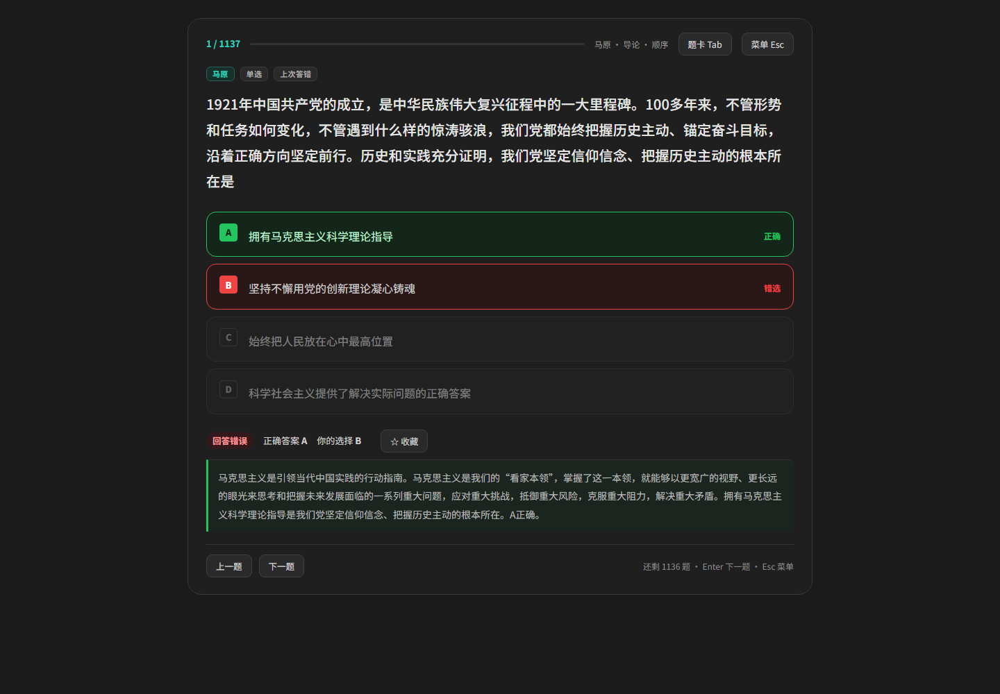
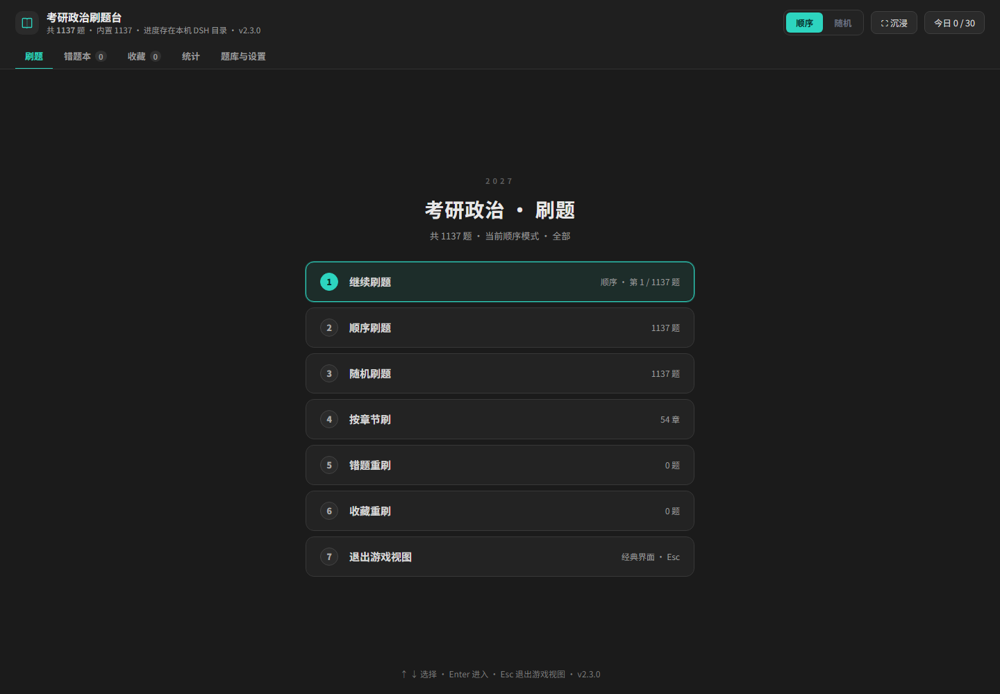
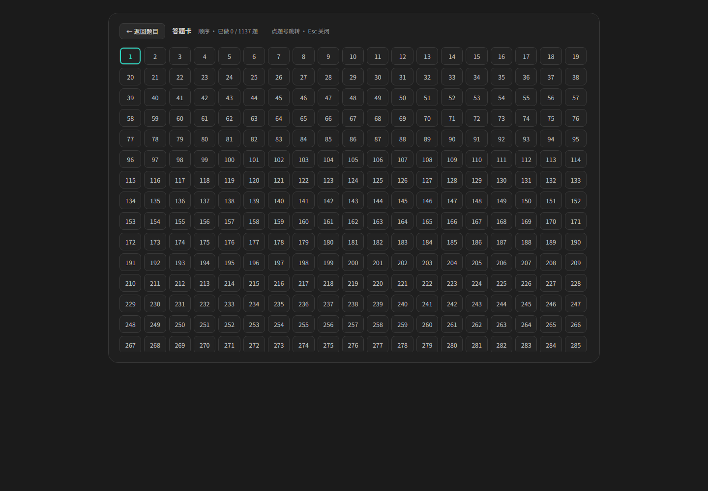

# 考研政治 1000 题 · 刷题插件

给 **DSH（DeepSeek Harness）** 用的考研政治刷题插件：左侧栏进入，开局是一屏菜单，进入后一屏一道题；键盘就能刷完，带题卡跳转、错题本、收藏和统计。

> 本仓库**只含插件代码 + 5 道演示题**。完整题库单独分发，安装后在「题库与设置」里填链接即可**一键导入**。



## 功能

- **两种入口**：开场菜单（继续 / 顺序 / 随机 / 按章节 / 错题重刷 / 收藏重刷），或经典面板（筛选 + 侧边答题卡）。
- **一屏一题**：题干居中大字号，选项大卡片，判分后展开对错与解析。
- **键盘作答**：`↑↓` 选选项、`Enter` 确认；多选 `Enter` 勾选、`Shift+Enter` 提交；`←→` 翻题。
- **题卡跳转**：`Tab` 打开答题卡，已做绿 / 答错红 / 当前高亮，点题号直接跳。
- **范围筛选**：科目（马原 / 毛中特 / 习思想 / 史纲 / 思法）、章节（带题数）、题型（单选 / 多选）。
- **一键导入题库**：支持本地 JSON、粘贴 JSON、**题库链接**（由 Host 下载，不受浏览器跨域限制）。
- **进度持久化**：Host 端 `state.json` + 浏览器镜像；切页面、换端口、重启后都能接着刷。

## 界面

| 开场菜单 | 刷题页 | 题卡 |
| --- | --- | --- |
|  |  |  |

## 安装

需要已安装并能启动 DSH（带 Web UI 的版本）。

```js
// DSH 插件管理里安装这个目录，或：
plugin_manager({ action: 'install_bundle', target: 'C:/path/to/kaoyan-quiz' })
```

安装后重启一次 DSH（或刷新页面），左侧栏会出现「政治刷题」图标。

## 一键导入题库

1. 拿到题库 JSON 的下载链接（见下一节）。
2. 打开「题库与设置」→ 题库 → 在输入框粘贴链接 → 点「从链接导入」。
3. 提示「已从链接导入 N 题」后即可开始刷；导入的题库会与内置题按 `id` 合并。

Host 直接下载并解析，所以链接可以是 GitHub Release、对象存储、你自己的服务器，**不要求对方带 CORS 头**。

## 自己分发题库

题库就是一个 JSON 文件（约 1.5 MB / 1000+ 题），放在哪里都行：

| 放法 | 说明 |
| --- | --- |
| GitHub Release asset（另一个仓库） | 上传后复制下载链接，最省事 |
| 对象存储 / OSS / R2 | 公开读权限即可 |
| 自己的服务器 / 网盘直链 | 只要返回 `application/json` 或纯文本 |
| 私有仓库的 raw 链接 | 需要带 token，不推荐给他人 |

导入后题库会落到 `%DSH_HOME%\kaoyan-quiz\bank-custom.json`，之后离线也能刷。

## 题库格式

```json
{
  "questions": [
    {
      "id": "demo-001",
      "subject": "马原",
      "chapter": "导论",
      "type": "single",
      "stem": "马克思主义哲学认为，世界的本原是",
      "options": ["精神", "物质", "意识", "理念"],
      "answer": "B",
      "explain": "唯物主义把世界的本原归结为物质……"
    }
  ]
}
```

- 必填：`stem`、`options`（按 A/B/C/D 顺序）、`answer`（如 `"B"` 或 `"BD"`）。
- 可选：`id`、`subject`、`chapter`、`type`（`single` / `multi`）、`explain`。
- 导入为整包覆盖，与内置题按 `id` 去重合并。

## 快捷键

| 键 | 作用 |
| --- | --- |
| `A`–`D` / `1`–`4` | 选择选项 |
| `↑` / `↓` | 上下移动选项高亮 |
| `Enter` | 确认 / 多选勾选 / 已判分下一题 |
| `Shift`+`Enter` | 提交多选 |
| `←` / `→` | 上一题 / 下一题 |
| `Tab` | 打开 / 关闭题卡 |
| `Esc` | 答题 → 菜单 → 退出沉浸 |

## 数据存在哪

| 内容 | 路径 |
| --- | --- |
| 刷题进度 | `%DSH_HOME%\kaoyan-quiz\state.json` |
| 导入的题库 | `%DSH_HOME%\kaoyan-quiz\bank-custom.json` |
| 内置题库 | 插件目录 `bank.json`（演示 5 题） |

## 目录

```text
kaoyan-quiz/
├── index.js            Host 路由：ui.js / bank / import / state
├── client.js           Client 注册：sidebar.panellist + main 面板
├── ui.js               界面（原生 DOM，无框架）
├── bank.json           演示题库（5 题）
├── cordis.patch.yml    插入插件行
├── locale/{zh,en}.json 插件管理页文案
├── icon.svg
└── docs/               截图
```

## 说明与版权

- 本仓库是**刷题引擎与界面**，不附带任何受版权保护的教辅内容；演示题为本仓库自写。
- 完整题库由使用者自行准备与分发，本仓库不提供、不托管；题库内容的权利归其原作者。
- 代码以 MIT 许可发布。

---

### English

A quiz plugin for **DSH (DeepSeek Harness)**: one question per screen, keyboard-first answering, answer sheet with jump-to-question, wrong-answer book, favorites and stats. Ships 5 demo questions only — bring your own bank. Supports one-click import from a URL (downloaded by the Host, no CORS needed). Code licensed under MIT.
